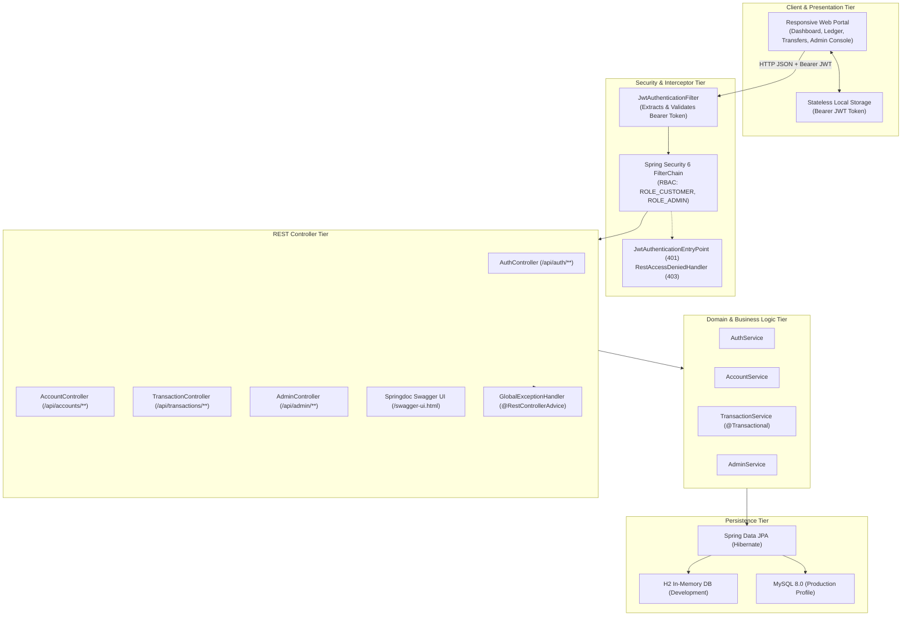
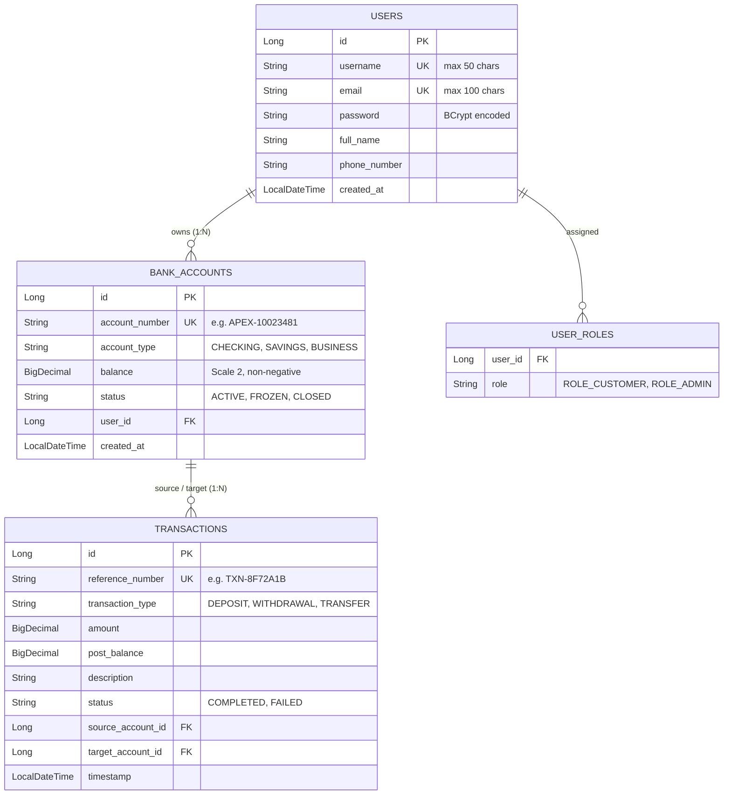

# 🏛️ Apex Financial Services — Enterprise Digital Banking Portal
**Enterprise Java Full Stack Capstone Project**

[](https://spring.io/projects/spring-boot)
[](https://www.oracle.com/java/)
[](https://spring.io/projects/spring-security)
[](http://localhost:8080/swagger-ui.html)
[](LICENSE)

---

## 1. Executive Project Overview

**Apex Financial Services** is a full-stack, enterprise-grade digital banking and capital treasury platform designed to demonstrate modern software engineering patterns in the Java ecosystem. The portal provides unified consumer banking (checking/savings/business accounts, ACID-compliant money transfers, ATM withdrawals, deposits, transaction auditing) coupled with an institutional **Admin Governance Console** (liquidity monitoring, compliance account freeze/unfreeze controls, real-time audit logging).

### Key Architectural Highlights
- **Stateless Bearer JWT Authentication**: Spring Security 6 with custom filters, HMAC-SHA256 signature validation, and RBAC (`ROLE_CUSTOMER`, `ROLE_ADMIN`).
- **Transactional Consistency & ACID Guarantees**: Robust `@Transactional` money transfers featuring automated balance validation, recipient verification, overdraft protection, and rollback handling.
- **Enterprise Exception Handling**: Unified `@RestControllerAdvice` interceptor yielding RFC 7807-compliant structured JSON errors across all validation, domain, and security violations.
- **Self-Documenting API Contract**: Native Springdoc OpenAPI 3 (Swagger UI) integration accessible at `/swagger-ui.html` with Bearer Authentication support.
- **Unified Single-Port Deployment**: Zero-configuration build serving both the responsive web portal and the REST APIs simultaneously on port `8080`.

---

## 2. High-Level System Architecture



---

## 3. Technology Stack & Key Dependencies

| Layer | Technology | Version | Purpose |
| :--- | :--- | :--- | :--- |
| **Backend Framework** | Spring Boot | 3.3.4 | Core framework, Auto-configuration, Embedded Tomcat |
| **Programming Language** | Java (JDK) | 21 / 26 | Modern Java syntax, Records, Enhanced Pattern Matching |
| **Security** | Spring Security 6 + JJWT | 0.12.6 | Stateless JWT authorization, BCrypt password hashing |
| **ORM / Persistence** | Spring Data JPA (Hibernate) | 6.5+ | Object-relational mapping, custom JPQL queries, ACID transactions |
| **Databases** | H2 Database / MySQL 8.0 | Embedded / 8.3+ | In-memory zero-config dev database + MySQL production profile |
| **Validation** | Jakarta Bean Validation | 3.0+ | Declarative DTO constraints (`@NotNull`, `@DecimalMin`, `@Size`) |
| **API Documentation** | Springdoc OpenAPI UI | 2.6.0 | Interactive API documentation at `/swagger-ui.html` |
| **Frontend Presentation** | HTML5 / ES6 Vanilla JS / CSS3 | Modern SPA | Glassmorphic design, responsive layouts, Lucide icons, Inter typography |

---

## 4. Domain Model & Entity Relationship



---

## 5. REST API Documentation & Endpoints

All authenticated requests require the header:  
`Authorization: Bearer <JWT_TOKEN>`

### 5.1 Authentication (`/api/auth/**`)
| Method | Endpoint | Access | Description |
| :--- | :--- | :--- | :--- |
| `POST` | `/api/auth/register` | Public | Onboards a new user and auto-provisions a checking account with $1,000 credit |
| `POST` | `/api/auth/login` | Public | Validates credentials and returns JWT Bearer token and role profile |
| `GET` | `/api/auth/me` | Customer/Admin | Returns profile of current authenticated user |

### 5.2 Accounts (`/api/accounts/**`)
| Method | Endpoint | Access | Description |
| :--- | :--- | :--- | :--- |
| `GET` | `/api/accounts/my-accounts` | Customer/Admin | Lists all portfolio accounts owned by authenticated user |
| `GET` | `/api/accounts/{accountNumber}` | Owner/Admin | Fetches detailed account information |
| `POST` | `/api/accounts/create` | Customer/Admin | Opens an additional account (Savings, Business, Checking) |
| `GET` | `/api/accounts/recipient/lookup?accountNumber=...` | Authenticated | Live recipient verification prior to transfer |

### 5.3 Transactions (`/api/transactions/**`)
| Method | Endpoint | Access | Description |
| :--- | :--- | :--- | :--- |
| `POST` | `/api/transactions/deposit` | Owner | Credits funds to an account with updated post-balance |
| `POST` | `/api/transactions/withdraw` | Owner | Debits funds with real-time balance and active status validation |
| `POST` | `/api/transactions/transfer` | Owner | Executes atomic debit/credit fund transfer between accounts |
| `GET` | `/api/transactions/history/{accountNumber}` | Owner/Admin | Retrieves full ledger history for a specific account |
| `GET` | `/api/transactions/recent?limit=10` | Authenticated | Retrieves recent transactions across all user accounts |

### 5.4 Admin Governance (`/api/admin/**`)
| Method | Endpoint | Access | Description |
| :--- | :--- | :--- | :--- |
| `GET` | `/api/admin/dashboard` | `ROLE_ADMIN` | Aggregated platform liquidity, volume, accounts, and user count |
| `GET` | `/api/admin/accounts` | `ROLE_ADMIN` | Audits all bank accounts across all system users |
| `PUT` | `/api/admin/accounts/{accountNumber}/status` | `ROLE_ADMIN` | Freezes or unfreezes an account |
| `GET` | `/api/admin/transactions?limit=50` | `ROLE_ADMIN` | System-wide audit stream of all transactions |

---

## 6. Seeded Demo Accounts (1-Click Login)

The system automatically initializes demo data upon startup via `DataInitializer`:

| Role | Username | Password | Accounts & Starting Balances |
| :--- | :--- | :--- | :--- |
| **System Admin** | `admin` | `Admin@123` | `APEX-90001001` (Checking: $100,000.00) |
| **Customer #1** | `john_doe` | `Password@123` | `APEX-10023481` (Checking: $12,450.50)<br/>`APEX-20045612` (Savings: $35,800.00) |
| **Customer #2** | `jane_smith` | `Password@123` | `APEX-30078923` (Checking: $8,720.00)<br/>`APEX-40089104` (Business: $54,300.00 - **FROZEN**) |

---

## 7. Quickstart & Installation Guide

### Prerequisites
- **Java Development Kit (JDK)**: 21 or higher installed (`java -version`)
- **Apache Maven**: 3.8+ installed (`mvn -version`)

### 1. Build and Test
Run clean compilation and automated unit/integration test suite:
```bash
mvn clean test
```

### 2. Run the Full Stack Application
Launch the unified full stack server:
```bash
mvn spring-boot:run
```

### 3. Access Portal Services
- **Web Portal Application**: [http://localhost:8080/](http://localhost:8080/)
- **Interactive Swagger UI**: [http://localhost:8080/swagger-ui.html](http://localhost:8080/swagger-ui.html)
- **OpenAPI v3 Raw JSON**: [http://localhost:8080/v3/api-docs](http://localhost:8080/v3/api-docs)
- **H2 In-Memory Console**: [http://localhost:8080/h2-console](http://localhost:8080/h2-console)  
  *(JDBC URL: `jdbc:h2:mem:apex_banking_db`, User: `sa`, Password: empty)*

---

## 8. Video Walkthrough Demonstration Script (3–5 Minutes)

When presenting this capstone project in a video demonstration, follow this structured script:

```
[0:00 - 0:45] INTRODUCTION & ARCHITECTURE OVERVIEW
"Hello everyone, welcome to the demonstration of Apex Financial Services, an enterprise full-stack digital banking platform built with Spring Boot 3, Spring Security 6 with stateless JWT Bearer tokens, Spring Data JPA, and a modern responsive frontend. 
Notice that the frontend and backend are seamlessly served on the exact same port (8080) for frictionless, production-grade deployment."

[0:45 - 1:30] CUSTOMER LOGIN & PORTFOLIO DASHBOARD
"Let's sign in using the 1-click Customer Demo button for 'john_doe'. Upon login, the client receives a signed JWT token which is stored for subsequent authenticated REST requests.
In the Executive Dashboard, we immediately see John's aggregate balance of $48,250.50 across his two accounts: a primary Checking account and a High-Yield Savings account.
Selecting an account smoothly filters the live transaction ledger below."

[1:30 - 2:45] ATOMIC FUND TRANSFER & BALANCE RECONCILIATION
"Now, let's demonstrate an atomic money transfer. We click 'Transfer Funds', pick our source checking account, and enter recipient 'APEX-30078923'. 
Notice the live recipient lookup instantly resolves this account to 'Jane Smith'. We enter $250.00 and execute.
The backend processes this in an ACID-compliant @Transactional block: debiting John's checking account, crediting Jane's account, and creating an immutable audit transaction record. The balance updates instantly to reflect the transfer."

[2:45 - 3:30] EXCEPTION HANDLING & VALIDATION CONTROLS
"Next, let's demonstrate our robust validation. If we attempt to transfer to Jane's frozen business account ('APEX-40089104'), the server returns a 403 Forbidden with a clean RFC 7807 error explaining the account is frozen.
Similarly, overdraft attempts return a 400 Bad Request with an InsufficientBalanceException."

[3:30 - 4:15] ADMIN GOVERNANCE CONSOLE
"Now let's switch to our System Administrator role ('admin'). 
In the Admin Operations Center, administrators have real-time visibility into Total Bank Liquidity Reserves, Total Transacted Volume, and Account Distribution.
Administrators can freeze or unfreeze accounts on the fly with a single click, instantly enforcing security across all transactions."

[4:15 - 5:00] SWAGGER OPENAPI & CONCLUSION
"Finally, navigating to /swagger-ui.html displays the interactive OpenAPI 3 documentation. Developers can authorize with their JWT token to test all endpoints interactively.
This concludes the walkthrough of the Apex Banking & Financial Services full-stack capstone project. Thank you!"
```

---

## 9. License

This capstone project is distributed under the MIT Open Source License. Built for enterprise evaluation and instructional excellence.
